# React Spotify Clone

<h3 align="center">
  Hello there, I've decided to share my Spotify clone project on Github, which I've been developing for a few days. 
  It has its shortcomings, I haven't discovered any bugs yet. Also, since the project is under development, your ideas
  and opinions are very important. If you have ideas and opinions, feel free to contact me via the links in my profile!
</h3>

## [Site is available in production](https://react-spotify-clone-beta-snowy.vercel.app/)

> **Update:** No Spotify API key is required anymore! The project now fetches live Turkey charts, artists, albums, tracks, and genres via the keyless Deezer Public API (proxied through Vite / Vercel serverless) with a local Turkish music fallback.

## Running Locally

```bash
npm install
npm run dev
```

## Screenshots
### *Language preference in the project is Turkish

<div>
  <h3>Login Page</h3>
  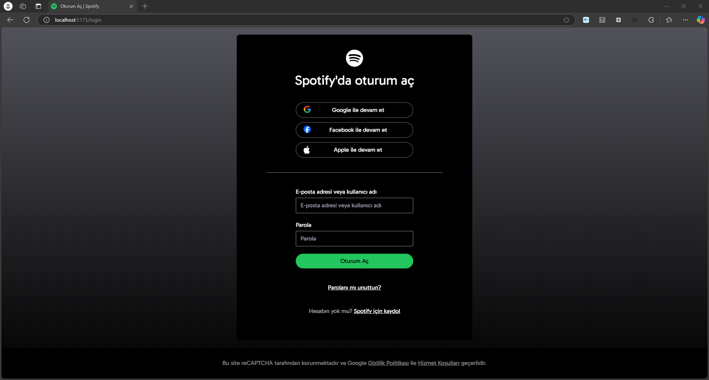
</div>
<div>
  <h3>Register Page</h3>
  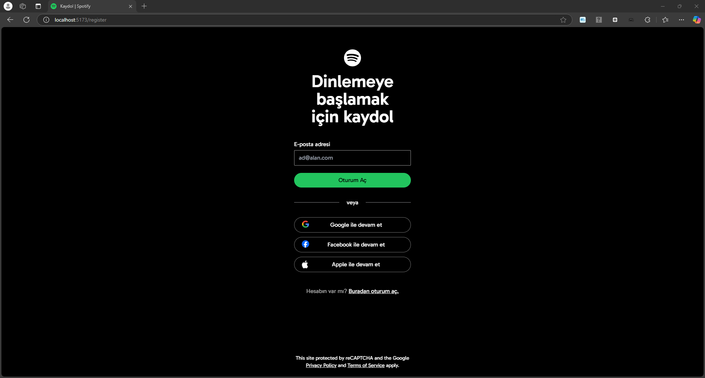
</div>
<div>
  <h3>Home Page</h3>
  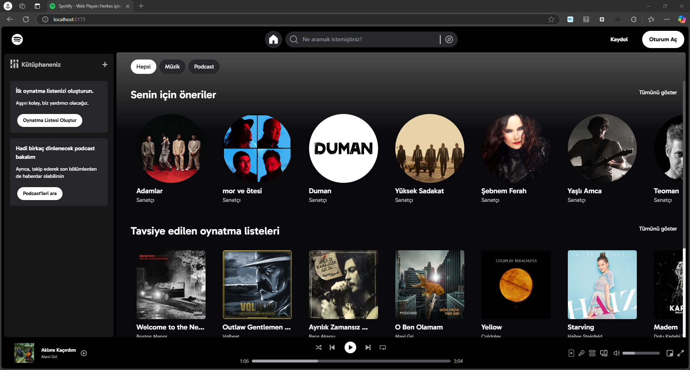
</div>
<div>
  <h3>Home Page - 2</h3>
  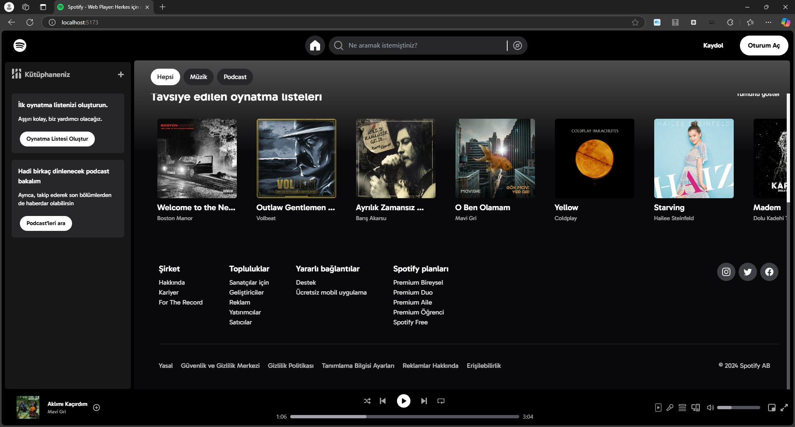
</div>
<div>
  <h3>Artist Page</h3>
  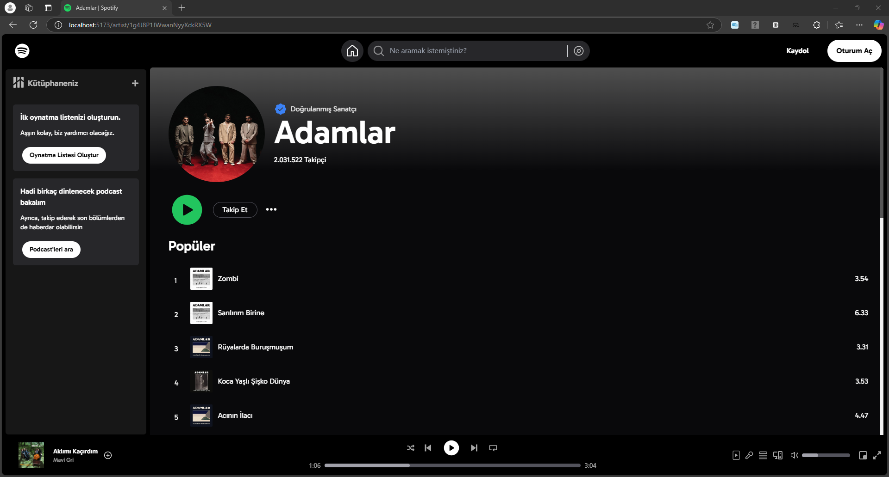
</div>
<div>
  <h3>Artist Page - 2</h3>
  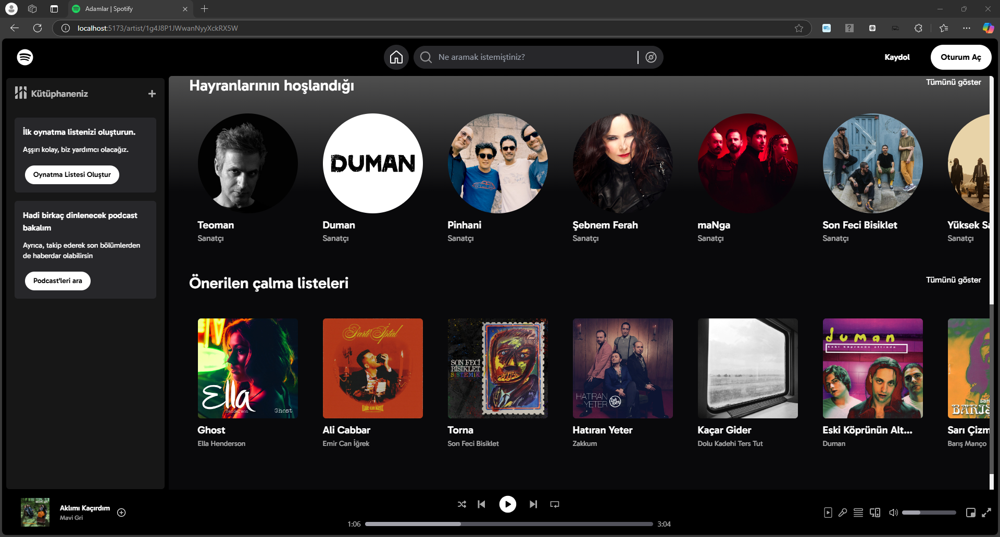
</div>
<div>
  <h3>Album Page</h3>
  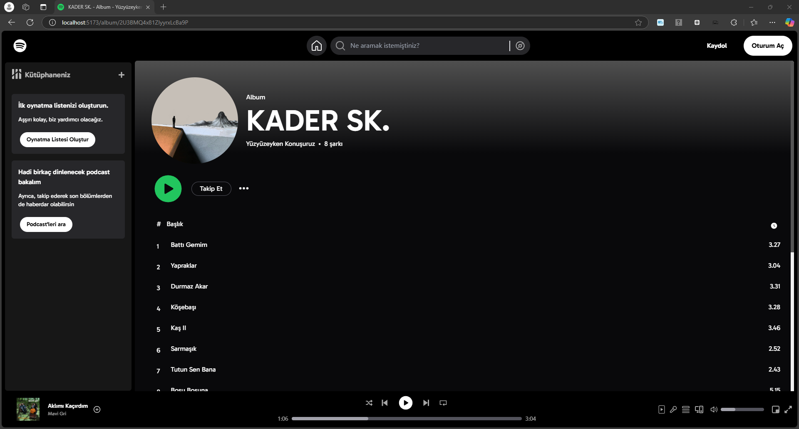
</div>
<div>
  <h3>Album Page - 2</h3>
  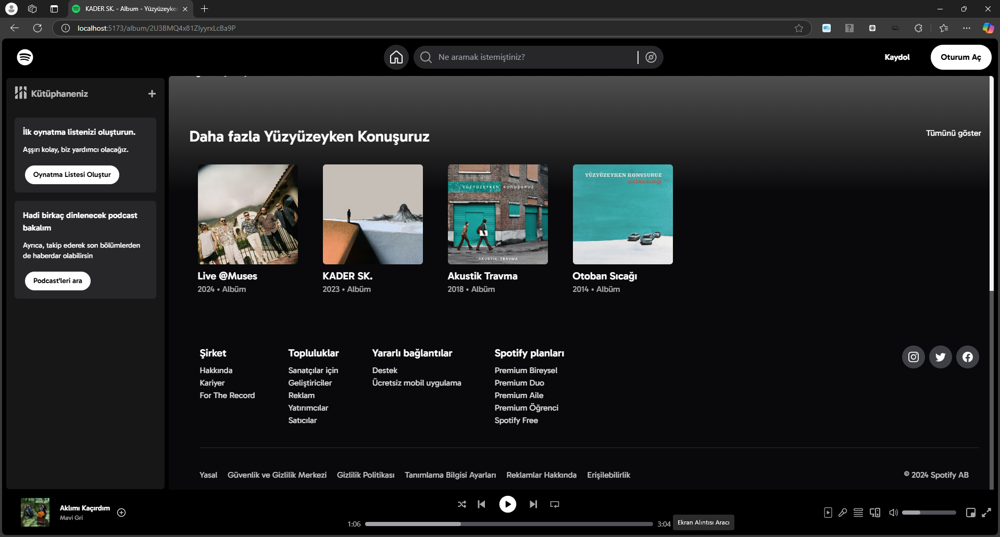
</div>
<div>
  <h3>Playlist Page</h3>
  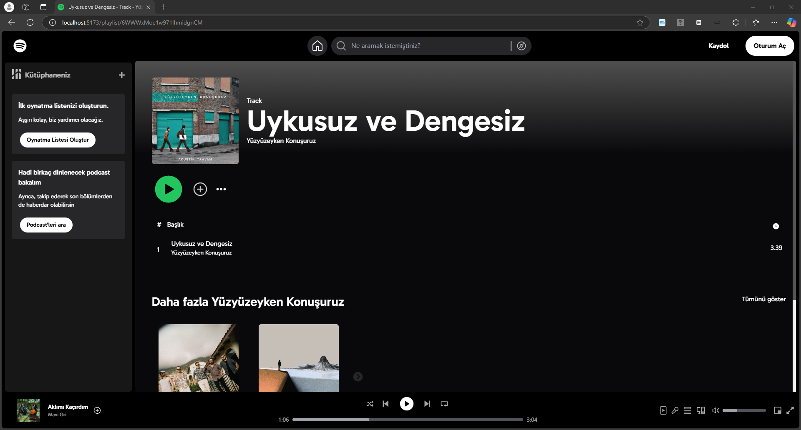
</div>
<div>
  <h3>Playlist Page - 2</h3>
  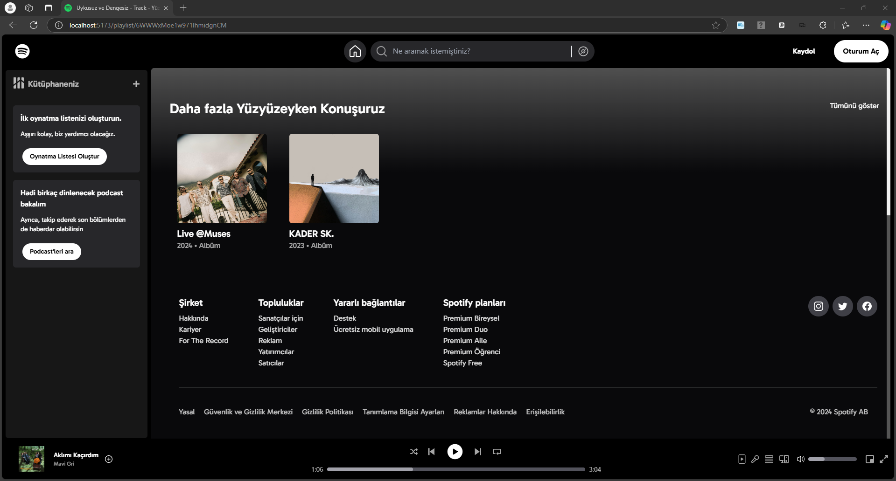
</div>
<div>
  <h3>Search Page</h3>
  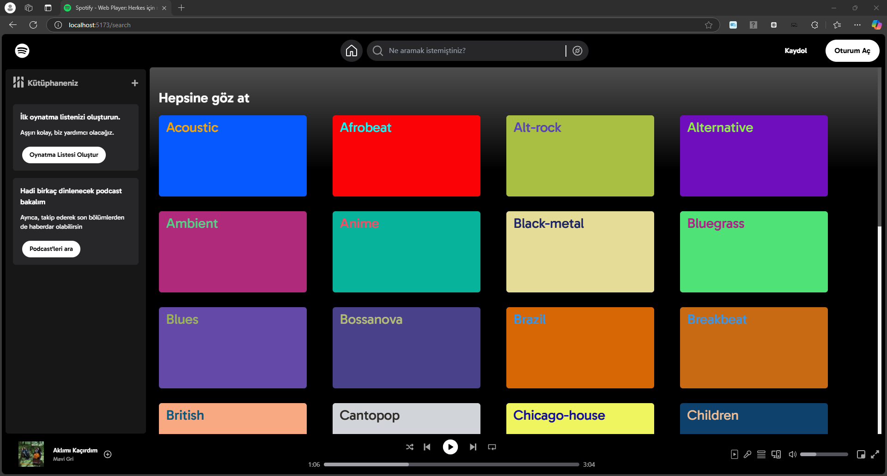
</div>
<div>
  <h3>Loading Page</h3>
  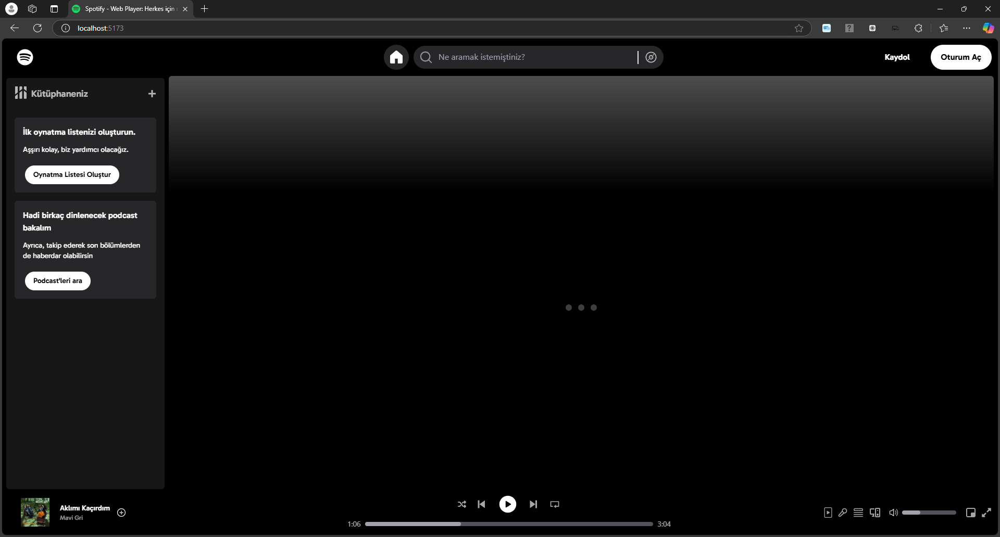
</div>

<div>
  <h1 align="center">That's all (for now!)</h1>
</div>
